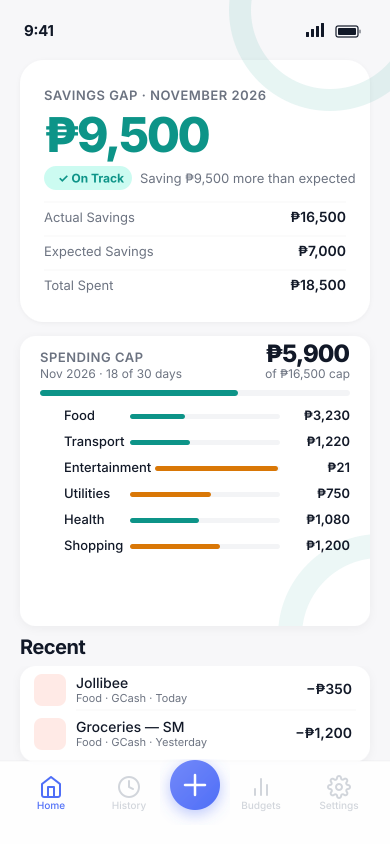
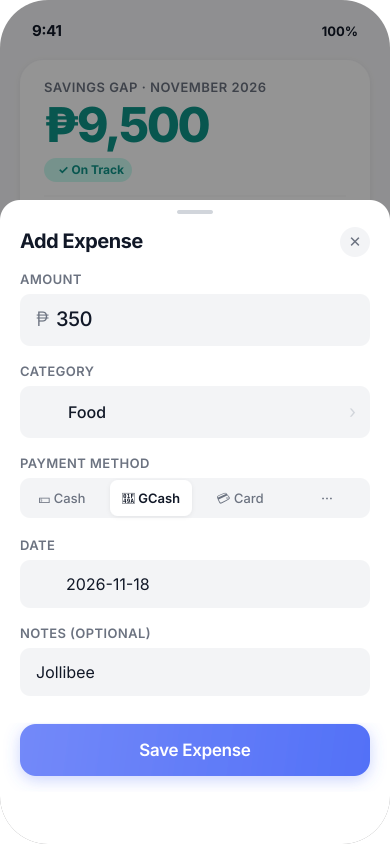
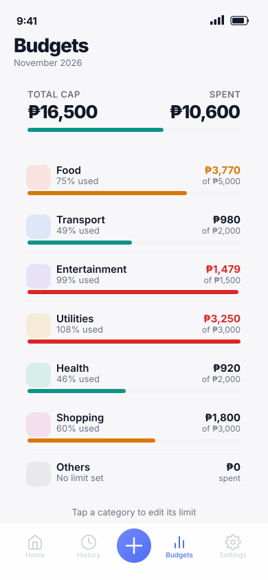
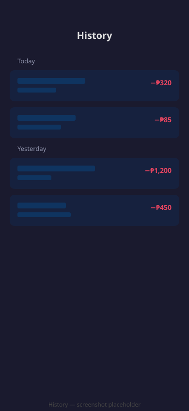

# GastosGo

Personal finance tracker for working Filipinos and students. Instead of listing expenses, it surfaces one number: the **Savings Gap** — how much less you saved this month than you planned, and exactly why.

> iPhone-first, Android-ready. Built with Expo managed workflow on Windows.

---

## Screenshots

| Home | Add Expense |
|------|-------------|
|  |  |

| Budgets | History |
|---------|---------|
|  |  |

> These screenshots are from the **base version** of GastosGo. The current app may look different as the design evolves. Interactive prototypes live in [`prototype/`](prototype/) — open any `.html` file in a browser.

---

## What it does

- **Savings Gap** — computes `income − spending_cap − actual_spend` per budget cycle so users see not just what they spent, but whether they're on track to hit their savings target.
- **Three income modes** — Salary (fixed), Mixed (salary + irregular), or Target (goal-only, no income logged).
- **Per-category budgets** — spending caps with live progress; budgets carry forward each cycle.
- **Offline-first** — all data lives in `expo-sqlite`; a sync queue drains to Supabase in the background when online.
- **Anonymous auth** — Supabase anonymous sign-in so there's no forced registration.

---

## Interesting engineering choices

| Decision | Why |
|----------|-----|
| `expo-sqlite` as source of truth, Supabase as sync target | Instant reads and writes with no network dependency; sync is best-effort and non-blocking |
| Custom sync queue with row-level operations | Handles offline edits, deletes, and conflict resolution without a third-party CRDT library |
| `@gorhom/bottom-sheet` + Reanimated for the add-expense sheet | Native-feeling gesture-driven sheet; shared across the FAB and a tab-bar redirect so the trigger point doesn't matter |
| Expo managed workflow from Windows → iOS | EAS Build/Submit handles the Xcode step remotely; no Mac required for the dev loop |
| Budget cycle snapshots | Each cycle stores an income snapshot so historical gap calculations stay accurate even after income changes |

---

## Tech stack

- **Framework** — Expo (managed), Expo Router, React Native
- **Database** — `expo-sqlite` (local) + Supabase (sync)
- **Animation** — React Native Reanimated, `@gorhom/bottom-sheet`
- **Auth** — Supabase anonymous auth
- **E2E** — Maestro
- **CI/CD** — EAS Build, EAS Submit, EAS Update

See [`docs/tech-stack.md`](docs/tech-stack.md) for the full rationale and [`docs/adr/`](docs/adr/) for architecture decision records.

---

## Repo layout

| Path | Contents |
|------|----------|
| `app/` | Expo Router screens — tabs, onboarding, settings |
| `src/components/` | Shared UI components (AddExpenseSheet, NavBar, TabBar, …) |
| `src/db/` | SQLite driver, migrations, row types |
| `src/lib/` | Supabase client, sync queue drain, push notifications |
| `src/utils/` | Domain logic — Savings Gap, Spending Cap, budget cycle helpers |
| `src/theme/` | Design tokens — colors, typography, spacing, shadows |
| `supabase/` | Database migrations and edge functions |
| `docs/` | Tech stack, E2E/release notes, ADRs |
| `prototype/` | Interactive HTML design prototypes |
| `GLOSSARY.md` | Domain language — canonical names for all domain concepts |

---

## Run locally

```bash
git clone https://github.com/justine-135/gastosgo.git
cd gastosgo
npm install
sh scripts/install-hooks.sh
npx expo start
```

Requires an Expo Go client or a simulator. Copy `.env.example` to `.env` and fill in your Supabase project URL and anon key.
